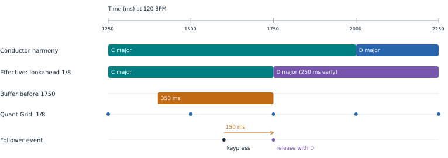
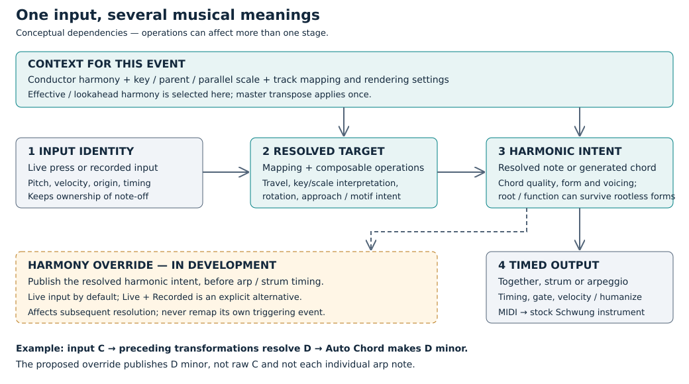

Warning: truncated output (original token count: 37059)
Total output lines: 1013

HarmonyBus 0.2.322 routes pad pressure to mapped sounding voices, including transposition, Together chords and internal Receiver tracks. See [Mapped note pressure](note-pressure.md).

HarmonyBus 0.2.321 adds pressure control to existing Rotate with signed Collection Steps, hysteresis, shared Remote UI/Launchpad input and unchanged onset/release ownership. See [Pressure Rotate](pressure-rotate.md).

HarmonyBus 0.2.320 adds pressure-controlled Voicing Rotate for live chord inversions. See [Voicing Rotate](voicing-rotate.md).

HarmonyBus 0.2.319 adds downward Chord Spread with an anchored top voice, alongside upward expansion with an anchored bass. See [Chord Spread](chord-spread.md).

HarmonyBus 0.2.318 adds pressure-controlled Chord Spread with an anchored bass and live held-voice retuning. See [Chord Spread](chord-spread.md).

HarmonyBus 0.2.317 adds a shared Global Transpose performance operation. See [Global Transpose](global-transpose-operation.md).

HarmonyBus 0.2.315 adds pressure-controlled Note Repeat and Repeat Divisions for Movy hbclean.338. See [Pressure repeat](pressure-repeat.md).

HarmonyBus 0.2.314 adds opt-in approach row pressure modes for Movy hbclean.337. See [Approach pressure](approach-pressure.md).

HarmonyBus 0.2.313 adds native queue export for Movy hbclean.318 Copy Queue. Update both modules. See [Copy Queue](queue-copy.md).

HarmonyBus 0.2.311 supports growing, retained Chord Play queues with Movy hbclean.314. Update both modules. See [Growing chord queues](growing-chord-queue.md).

HarmonyBus 0.2.310 completes the motif Relative Operation editor with Movy hbclean.284. See [Motif RPO editor](motif-rpo-editor.md).

HarmonyBus 0.2.309 adds Fixed/Adaptive motif-to-clip export with Movy hbclean.282, reusing onset resolution and ownership. See [Fixed and Adaptive motif export](adaptive-motif-export.md).

HarmonyBus 0.2.307 applies the parent key before the first conductor chord. Pair with Movy hbclean.275. See [parent key and pad position](pad-parent-key.md).

HarmonyBus 0.2.306 adds cached resolved-operation feedback, shared short labels and Smart key-context agreement with Movy hbclean.274. See [Resolved operation feedback](resolved-operation-feedback.md).

HarmonyBus 0.2.305 adds native chord discovery and non-recording voicing audition for Movy hbclean.273. See [Chord Discovery](chord-discovery.md).

HarmonyBus 0.2.304 adds eight-note input scales, Smart operation lanes and adaptive authored motif steps. Pair with Movy hbclean.272. See [relative operations](relative-operations.md).

HarmonyBus 0.2.303 adds Smart Below / Smart Above bank selectors and shared relative-operation definitions. See [relative operations](relative-operations.md).

HarmonyBus 0.2.302 derives Chord Play quality hues from the resolved chord scale, independently of voiced form. See [implied quality](implied-quality.md).

HarmonyBus 0.2.300 fixes chord labels, exposes the ordered live queue and recognizes overlapping touch phrases automatically with Movy hbclean.260. Numeric depth is the start/refill threshold; the final release commits an overlapping phrase regardless of that threshold. Existing playback keeps its clock. Includes the merged Euclidean Fill rhythm editor. See [Chord loop and entry](chord-loop.md).

HarmonyBus 0.2.301 adds top-note chord ranges through the existing voicing engine and isolates chord-bank display caches from musical transformations. Sustained-play crackle improvement still requires device verification.

HarmonyBus 0.2.299 adds Euclidean Fill to the existing shared rhythm User 1–4 slots. Edit draft steps (1–16), hits and rotation, inspect the non-destructive pattern preview, and explicitly Apply to change attack/rest positions while preserving accent/gate controls. Playback continues through the existing clock, chord/arp logic and harmonic travel. No Movy update is required. See [Euclidean Fill](euclidean-rhythm.md).

HarmonyBus 0.2.298 adds queued Chord Play with grid/anticipation timing, follower lookahead, and shared motif Next Chord destinations. The final chord holds when the queue empties. Pair with Movy hbclean.250 for queued controls and conductor activation recording. See [Chord Play](chord-play.md).

HarmonyBus 0.2.291 adds silent conductor chord selections with recorded chord/scale snapshots. Comping keeps its existing source rhythm and arp phase. Pair with Movy hbclean.234 for Chord Play and HB Settings.

HarmonyBus 0.2.282-dev.2 preserves override bass inversions, adds on-demand source diagnostics and validates shared surface events. Development candidate; hardware acceptance pending.

HarmonyBus 0.2.281 extracts the shared portable musical core without changing musical behavior. Preserves the 0.2.280 scale diagnostics, rhythm performance and Grid gates. Pair with Movy hbclean.202 for opt-in stock FM-1 USB MIDI input; no firmware update is required.

HarmonyBus 0.2.280 adds effective-scale diagnostics and reuses Simplified target policy for established minor tonics. Parallel Scale remains the shared parent operation.

HarmonyBus 0.2.279 separates motif pitch material from generated rhythm: attacks cycle through playable motif events while the selected pattern supplies rests, ties, accents and gates. Held-note pitch changes take effect at the next attack, and release finishes the current gate. Rhythm-filled clips use existing arp ordering on their written attacks without a second clock. Includes Grid Sequencer support from 0.2.278; pair with Movy hbclean.201.

HarmonyBus 0.2.278 adds sequenced operation gates for Movy Grid Sequencer. Scheduled holds are independent of physical holds, reuse existing operation settings, and can launch the existing motif scheduler against a held target. Pair with HarmonyBus-Movy hbclean.200. Includes the 0.2.277 shared rhythm generator and earlier dominant palettes and extension settings.

HarmonyBus 0.2.277 adds shared attack/rest/tie rhythm patterns with accents and gates, five presets and four editable global slots. Tracks select their own pattern, span and Repeat/Once/Fit behavior; Joint Play exposes a fixed rhythm page for each actor. Chords and arpeggios share the pattern clock. Motif fills reuse the same patterns with Motif or Target notes and preserve target placement. Install Movy hbclean.199 for the actor panels.

HarmonyBus 0.2.275 adds Chords > Extensions: As Derived / Raise Avoid. Generated 9ths, 11ths and 13ths share the follower avoid-note classifier, preserving chord identity, suspensions and explicit detected chord tones. The choice applies on the next onset and persists in track settings and Chord/Arp State lanes. Existing sets retain As Derived. No Movy update is required.

HarmonyBus 0.2.276 adds Chords > Extensions: As Derived / Raise Avoid. Generated 9ths, 11ths and 13ths share the follower avoid-note classifier, preserving chord identity, suspensions and explicit detected chord tones. The choice applies on the next onset and persists in track settings and Chord/Arp State lanes. Existing sets retain As Derived. No Movy update is required.

HarmonyBus 0.2.274 adds Raised-Avoid beside Non-Avoid in Foll Map > Follower Content. Eligible avoid tones are raised by one semitone while chord tones, saved content IDs and approach behavior are preserved. Relative travel retains the raised degree; pad scale feedback uses the same collection. Auto Chord extension generation is unchanged. No Movy update is required for this feature.

HarmonyBus 0.2.273 consolidates rhythm pattern weights across live rendering, motif playback and motif clip export. Motif export and padding now honor the track Inherit/Off/Override rhythm setting. Movy hbclean.198 consumes an HB-provided timing recipe; older hosts retain the existing protocol. Pattern choices, target arrival, ties and saved state formats remain compatible.

HarmonyBus 0.2.269 reduces shared live-note and preview scale arithmetic: rotate the twelve-bit pitch mask directly and skip chord accommodation when every chord tone already belongs to the parent scale. No new cache or separate surface mapper. Exact arithmetic comparisons and complete Move/Launchpad snapshot comparisons preserve rendering. Keep Movy hbclean.189 and the current host. Desktop savings do not establish a hardware crackle fix; the existing CPU TIME capture remains the device check.

HarmonyBus 0.2.268 skips unused motion-value evaluation in the shared note-output and pad-preview path, preserving recorded and held operation replacement without a new cache. It also fixes held motion overrides treating packed recorded outcomes as huge event counters. Preview snapshots remain unchanged; output-stage parity and held-counter regression checks cover the changes. Keep Movy hbclean.189 and the current host; use its existing CPU TIME capture for hardware comparison. Hardware crackle improvement remains unconfirmed.

HarmonyBus 0.2.267 removes repeated all-track key and chord/arp synchronization from every Movy MIDI tick. Shared work uses the existing audio-block barrier; each track keeps its local updates, and MIDI/settings entry remains immediate. Differential event traces match the old traversal across playback, stopped transport, arps, key changes, previews and rapid note edges. Keep Movy hbclean.189 and the current host. This reduces measured desktop CPU work; hardware crackle improvement is not yet confirmed.

HarmonyBus 0.2.266 removes unused follower mapping calculations from synchronous pad previews and live notes. All four split modes retain identical preview output in differential tests. Adds short release/repress edge-order regression coverage. Compatible with installed Movy hbclean.187; only HarmonyBus needs updating. No host or buffer changes; this is a measured CPU reduction, not a confirmed hardware crackle fix.

HarmonyBus 0.2.263 key-center operations distinguish persistent live control from clip-owned modulation events; see [Key center operations](key-center-operations.md).

HarmonyBus 0.2.262 / Movy hbclean.179: Coherent Move and Launchpad pad snapshots for Movy hbclean.179, reusing identical rendered inputs within each read. The paired Movy update batches external note input, makes Launchpad pulses steady, paces LED traffic and widens footer arrows. No Schwung host changes. Physical Move latency and crackle testing remain necessary.

HarmonyBus 0.2.261 / Movy hbclean.178 adds Motif to Clip: preview and write editable input notes with harmonic instructions, shared target placement, optional even-unit padding, and normal Undo. Boundary targets are stored separately; interior targets remain. See the [motif loader guide](motif-loader.md) for controls and write modes.

HarmonyBus 0.2.259: Reuse identical pad renders within each display snapshot. Preserve current/next colors, output groups, approach intent and trails while avoiding duplicate pitch-class probes. Live and recorded playback rules are unchanged. Compatible with Movy hbclean.176. Desktop profiling improves preview cost; physical Move crackling still needs verification.

HarmonyBus 0.2.260 defaults regular Follower Travel to None, while Follower Key Travel stays Relative. Closest mappings softly favor ordered scalar runs within their original six-semitone radius and class boundaries, retaining the destination pitch-class multiset. Movy hbclean.177 defaults fresh sets to the Approach layout; saved choices are preserved. HarmonyBus 0.2.260 gives Follower Travel, Conductor Key Travel and Follower Key Travel the same seven choices, with independent saved selections: Relative, Nearest Octave, Closest Chord Tone, Closest Scale Tone, Closest Split, Upward and Downward. Relative carries the phrase using one shortest tonic shift and destination scale degrees; Nearest Octave folds each mapped degree toward its original register. Closest conductor voicings preserve the complete destination chord before choosing an inversion. Upward/Downward preserve mapped degrees while choosing their directional octave. MIDI boundaries can force the available octave. Regular follower Closest remains a legacy alias for Closest Scale Tone; None and Same as Conductor retain their separate bypass/inheritance roles. Existing Relative follower phrases may change octave where the old mapper folded individual degrees. Travel=None still applies the active dominant family: in D Dorian, A7 raises the seventh-degree output from C to C#. Follow Detected colors preserve that corrected dominant identity; next/full-next colors compare the pad output rendered now against the next chord.

HarmonyBus 0.2.258 fixes displaced playing highlights while paused: opening-chord previews no longer replace the live mapping used to locate sounding notes. Current, next, full-next, approach-row and selected-tone pulse colors now compare the same currently rendered pad note against their respective chord tones. Next coloring answers what can be played into the next chord now, rather than predicting which input will work after its mapping changes. The shared pass also removes repeated future-context rendering. Compatible with Movy hbclean.172; only HarmonyBus needs updating.

HarmonyBus 0.2.256 preserves the conductor's chord progression through Key Center changes, then uses the shared closest-assignment engine to choose an inversion near the recorded range. Follower Closest Split maximizes available pitch-class diversity within its chord-tone and non-chord-tone pools; it never crosses those classes for diversity. Complete generated conductor chords retain their destination tones and voice counts. The current/next footer follows the transformed harmony. Reused preview assignments, direct octave selection, and skipped inactive operations reduce repeated pad work. Next Pulse Off is explicit, and color-only previews skip unused trail targets. Compatible with Movy hbclean.172; device crackling still requires Move testing.

HarmonyBus 0.2.255 derives active Key Center pad-color membership, next-harmony pulse roles, and root highlighting from the same functional harmony transformation used by playback. For example, G7 resolving into A minor is colored as E7 rather than Em7. Key Center now displays Armed before a target is known and Arm>destination for a held target or scheduled motif landing. The committed key is available immediately without another note. This is a visual correction; the reported Key Center crackling is not yet resolved. Compatible with Movy hbclean.172.

HarmonyBus 0.2.254 fixes played-target trails: every pad-color mode uses the effective playing harmony, independent of full-lookahead background colors. Partial lookahead remaps remembered sounding pitches immediately; Current Chord history expires at the unshifted learned chord boundary, not at the anticipation point. Existing decay, pitch/pitch-class matching, and generated-voice filtering remain unchanged. Compatible with Movy hbclean.172; only HarmonyBus needs updating.

HarmonyBus 0.2.253 / Movy hbclean.172 groups Key Center Travel for Conductor, Follower Recorded and Follower Live on Harm Play Settings. Both follower settings default to Same as Conductor and apply to Follower Travel=None (including legacy Direct). Choices are Relative, Closest Chord Tone, Closest Scale Tone and Closest Split. Relative uses one tonic displacement across the phrase instead of independently choosing an octave for every note. Closest Scale Tone uses the new parent collection; Closest Split uses the track's split groups. Chromatic stays On by default: targets relocate before chromatic or recorded approach intent is applied. Recorded notes are unchanged, and these policies remain editable playback settings. The eight settings knobs are Key Center Scale, Conductor Travel, Follower Recorded Travel, Follower Live Travel, Parallel Scale, Target Scale Source, Dominant Color Family and Release Length. Chord + Arp retains its Shift-turn shortcut on Harm Play Controls.

HarmonyBus 0.2.252 / Movy hbclean.169 unifies dominant intent. Secondary II/IV/VI (Dom), V and leading-tone operations share the selected Dominant to Major or Dominant to Minor collection. The resolution target's actual third chooses the family, including an anticipated Key Center scale. Preparation roots are degrees of that collection. Minimal preserves the parent collection with only changes required for the dominant chord; None keeps substitution disabled. Plain secondary operations retain their parent baseline. Sparse forms retain full functional identity independently of sounding notes, including scheduled motifs and learned harmony playback. While dominant intent is active, ordinary scale-tone output uses that collection too: A natural minor with E7 intent and Harmonic Minor or Minimal raises input G to G#.

HarmonyBus 0.2.251 / Movy hbclean.168 makes armed Key Center approaches anticipate the destination scale. With Key Center Scale set to Use Parallel Scale, the selected scale supplies the target's third before the landing: Major, Lydian and Mixolydian targets use Dominant to Major; Natural Minor, Dorian and other minor-third targets use Dominant to Minor. Nested cadence targets use their own third within that destination collection. The current key changes only when the target/phrase anchor lands, including touch-driven V-to-target sequences. Recorded approaches retain their anticipated scale.

Key Center LatchOn arms the next eligible live target; it does not adopt an already-held note or continuously re-arm on subsequent notes. The committed key persists until switched off or replaced. Its current label and the performance footer update on the normal bounded feedback poll without another note. Same-tonic scale changes remain visibly active. To select a chromatic tonic, use a normal chromatic input (for example Chromatic input with Fourths layout), arm Key Center, and play the desired pitch. Dedicated spatial approach pads are not landing targets. Follower targets follow the unoperated travel mapping; a Conductor or Travel None gives direct pitch selection.

HarmonyBus 0.2.251 / Movy hbclean.166 includes Dominant Color on Harm Play Settings knob 5. Touch applies the selected dominant family to the current track, release restores the underlying major/minor settings, clockwise turn latches, and counterclockwise turn switches it off. Shift-turn selects a family (Altered V initially). Hold is solid teal; latch pulses teal. Only the selected family is saved; active holds/latches reset on stop or reload. Altered V shares its collection with dominant preparation and leading-tone operations.

In Movy hbclean.166, Harm Play Settings knob 8 advances an active motif on a held target without recording a new input press. Chord + Arp can adopt an existing physical hold independently of Retrigger Held. Releasing the adopted target ends a one-shot; explicit latch persists. Rapid release/repress preserves the attack even between audio ticks. Secondary V (Dom) uses a semitone-below leading-tone approach for diminished destinations. Harmony Setup in Steps offers Reset Track via Shift + touch, preserving clips and shared settings while restoring track-number HarmonyBus defaults.

Target Scale Source and the Simple Major, Minor and Dim families are in Harmony Setup in Steps mode. The control remains usable alongside the sixteen Harm Play step assignments. A conductor color suspends learned predictions while active and reuses its saved baseline timeline on release; it does not replace that timeline with a temporary performance.

Dominant to Major and Dominant to Minor now default to Simplified Target: major destinations use Major and minor destinations use Harmonic Minor. None disables dominant substitution and keeps the parent collection. Every enabled dominant family retains the dominant root, major third and flat seventh. Altered V applies to the entire dominant family, including preparation roots and leading-tone operations. Existing saved family selections are preserved.

Copy-tap filters the HarmonyBus panels by mode. Steps contains setup and diagnostics; Perform 1 contains operation controls and performance tools; Perform 2 contains Harm Play, secondary harmony and chord/arp controls. Startup and project load always select Steps. Copy hold retains native copying; switching modes does not reset latched musical operations.

Learned next-harmony timelines are saved per conductor track and clip slot. Matching clips recover their predictions on the first playback after a reload; edits and incompatible render settings invalidate the corresponding record. The stopped opening-chord preview remains independent. Trail Decay has one larger preview below readable text controls; selectors clear the surrounding controls.

**HarmonyBus 0.2.243 / Movy hbclean.159 — target scales and full Harm Play banks.**

Secondary Fifth is now a separate parent-scale degree operation. Secondary II, IV and VI (Dom) simplify the target in Auto and use its dominant-preparation family; Altered V supplies the same collection to all dominant operations. Ordinary secondaries preserve the parent collection by default. Parent/Simplified explicitly overrides Auto target simplification. Existing operation IDs are unchanged.

The performance footer now shows compact mode/track, sounding key center and parent scale, and current > next harmony as key-relative Roman numerals. Unknown harmony is --; h7 means half-diminished. Long scale names are abbreviated to fit. Footer data rides the existing pad snapshot without additional host reads.

Trail reinforcement starts a single target onset at 80% of Trail Strength and a repeat within the selected history window at 100%. Dim Trail decays toward 30% of Trail Strength; Blend into Background still fades to the background. Repeats refresh the peak and decay continuously. Pitch Class combines octave hits. Generated chord voices and arp repeats do not count. The native history retains two onsets per pitch, including hits between UI polls. Install HarmonyBus 0.2.244 and Movy hbclean.160 together; Movy retains single-hit compatibility with older history snapshots. Validated against Schwung 1.7.3.

Harm Play 1 and 2 now expose all sixteen saved operation/motif assignments, matching step buttons 1–8 and 9–16. Harm Play Settings holds Key Center, Parallel Scale, Motif Latch and Chord + Arp on knobs 1–4; the step buttons remain playable from this page. Shift-turn Parallel Scale still selects its scale. The four special controls retain teal feedback, captured releases and latch behavior. Key Change Scale and Conductor Travel remain on Key & Scale.

Settings knobs 5–8 are Target Scale Source, Simple Major, Simple Minor and Simple Dim. These are saved per track:

**Auto** uses the parent collection for ordinary secondary degrees and simplifies the destination for Secondary V and Leading Tone. Existing Simple Chord/Simple Scale operation choices remain active in Auto.
**Parent** keeps the destination's parent collection, including the established borrowed/chromatic-target fallback. **Simplified** uses the selected destination-quality family. Both explicit choices override legacy per-operation simplification flags.
Major: Major (default), Lydian or Harmonic Major. Minor: Natural Minor (default), Dorian, Harmonic Minor or Melodic Minor. Diminished/half-diminished: Locrian (default) or Locrian #2.

The destination's third and fifth select the quality family. Existing Dominant to Major/Minor treatment is applied afterward; a named dominant-family choice can therefore override the simplified collection on ii/V/leading-tone approaches. Minimal keeps the parent with necessary dominant-chord alterations; None disables substitution. Dominant and leading-tone chord function is retained. Live chords, single-note approaches and motif/cadence rendering share the resolver; stored source pitches and assignment IDs are unchanged. Old states without these controls load Auto with the default families, so explicit dominant/leading-tone approaches now use Auto's tonicized destination collection. Existing held voices finish with their onset pitches.

Standalone HarmonyBus exposes the same four choices on Secondary Scales. Install both versions for the complete Movy settings page. Device audio crackles remain a hardware verification item.

**HarmonyBus 0.2.242 / Movy hbclean.155.** Adds Live Harmony Override (default scope) and Live + Recorded Harmony Override, using resolved musical intent with conductor harmony underneath. Chord + Arp now offers six combinations: Chord Only, Arp Only or Both, resolving on first target press or release. Persistent latches stay active.

Movy adds Pad Trails under Shift + Step 9: turn the dial through Set Parameters, Pad Colors, Pad Trails and Trail Decay. Trails remember a resolved single target per input gesture, never every generated chord voice or arp repeat. Exact pitch is the default; pitch class is optional. History is matched against each pad's displayed current/next target. Choose infinite, beat, current-chord or previous-plus-current-chord history, color/strength/pulse, linear or exponential decay, and exponential shape 0.5/1/2/4. Exponential duration is a half-life. Chord Forms stays grouped as before.

Color order is harmony/pulse, trail overlay, played highlight, then approach-row brightness. Trails share the existing bounded pad snapshot; animation performs no native reads. Copy-mode layout changes reuse cached metadata and release physical holds without resetting all performance state. Hardware crackle behavior still needs Move testing.

**HarmonyBus 0.2.241 / Movy hbclean.154 — conductor-owned shared context.** While recording a conductor, Key Center landings, Parallel Scale starts/ends and explicit parent-scale changes are saved on that clip's musical timeline, including changes performed without a note. Follower uses remain live-only. Ordinary chord/arp settings, timing and humanize remain current rendering controls; this does not introduce general knob automation. Infer remains a live base-scale selection.

Conductor contributions are aggregated before each sequencer MIDI batch. A clip owns its contributions; ending a gesture, stopping a clip or replacing a set removes that ownership, without restoring stale global snapshots. A gesture crossing the loop boundary remains active until its recorded ending. Playback from the middle reconstructs the circular timeline. Explicit selections use the most recent active contribution (higher track number breaks exact ties); live gestures override recorded contributions until released. Key/parent changes persist in the clip until replaced; a momentary take closes at recording end, while a latch remains persistent. Master Transpose applies once outside the stored key changes. The target note of a recorded key landing retains the key context in which it was performed, avoiding a second key mapping on later loops; its chord form can still be edited.

**Context Sources** shows Sounding Key, Base Key, Key Owner, Parallel Owner, Parent Owner, Transpose, Sounding Scale and capture status. `T2 REC` / `T2 LIVE` identify the winning owner; `+` indicates additional overridden contributions. Existing operation lights reflect the current track's ownership. The page uses one bounded snapshot read; no new pad animation or per-cell polling. Sparse events use binary lookup, and global replay writes happen on changes rather than every audio block.

Validation includes native ownership/transpose/onset tests, the sequencer and DSP suites, loop carry and persistence, and the full Movy/Schwung/HB chain recording and replaying independent conductor contributions. Device crackle resolution remains a hardware verification item. Future-key-event lookahead visualization is not added in this release; the new panel reports the effective shared context.

**HarmonyBus 0.2.240 / Movy hbclean.153:** Pads Global > Pad Colors > Harmony Off keeps an input-scale/tonic background and played-input feedback without current/next-harmony coloring, harmony pulses or rendered-output grouping. The native snapshot skips per-pad voice previews and lookahead color analysis in this mode; unchanged layouts no longer repeatedly submit preview inputs. This is a display choice and does not disable musical follower mapping or lookahead timing.

Transport heartbeats, clip-position updates and opening-preview telemetry no longer trigger the general all-track settings/Chord+Arp resynchronization path. The existing conductor-before-follower barrier and ordinary settings synchronization remain. A 16-track desktop benchmark reduced the heartbeat dispatch portion from about 47 to 12 microseconds; this is not a hardware deadline measurement or confirmation that device crackles are resolved.

**HarmonyBus 0.2.239 / Movy hbclean.152:** Track Scales has independent Dominant to Major and Dominant to Minor preferences. Parent / Minimal is the major default; Harmonic Minor is the minor default. Both offer Parent / Minimal, Harmonic Minor, Melodic Minor, Altered V, Major and Harmonic Major. Selection follows the resolution target's quality before borrowing, including explicit secondary intent. Named families apply to generated preceding ii and V; Altered V now also supplies preparation and leading-tone collections. Explicit chord tones remain authoritative. Auto Local preserves available parent modes rather than always rebuilding major/natural minor. Harmonic Major is also in the shared regular and parallel scale library. Key changes preserve dominant and leading-tone function, including conductor output. Ordinary Scale Degree output uses the active dominant collection while input labels retain their source scale.

Movy submits changed melodic pads as one bounded native cable frame, removing Schwung's 16-LED-per-UI-tick staging on supported hosts; immediate melodic feedback uses the same path. Rejected frames retry and the existing 40-packet budget remains. HB no longer repeatedly reads saved set files to discover channel ownership in an audio callback; unresolved Auto channels wait for authoritative host source tags (or an explicit source channel). These changes remove identified sources of work and display staggering, but the reported device crackles still require hardware verification.

**HarmonyBus 0.2.238 / Movy hbclean.151:** Blues is available in both Parallel Scale and the regular scale library. It uses Dorian melodic degrees with dominant chord quality on every root, retaining chord forms (major triads, dominant sevenths, dominant ninths). The old six-note keyboard scale remains at its saved ID as Blues 6-note. Scale definitions now come from HarmonyBus `data/scales.json`: intervals, names, stable host/keyboard IDs and chord policy generate native tables, module choices and the pinned Movy catalog. Relative Major/Minor remains a separate parallel operation. CI rejects stale generated catalogs.

**HarmonyBus 0.2.237 / Movy hbclean.150:** Shift-turn Chord + Arp selects Chord Only, Arp Only, or Both. Ordinary clockwise/counterclockwise turns permanently latch on/off; the existing teal latch pulse remains. Chord Only bypasses arpeggiation, Arp Only uses played notes without chord expansion, and Both combines them. Selection is saved; old sets retain Both. Mode boundaries release old voices safely. Pad-preview reads now remain limited to one per 50 ms even during rapid gesture changes; note feedback and native LED pulses remain independent. This reduces display traffic but does not establish or eliminate the reported hardware audio scratchiness.

**Key changes (HarmonyBus 0.2.237 / Movy hbclean.145):** Harm Play knobs 1–4 remain motif/approach entries. Knob 5 arms a shared key-center change; the target pad sounds under the old context, then later onsets use the new context on all conductor and follower tracks, including MIDI rendered to Schwung stock tracks. A motif waits for its anchor. Queued landing notes retain their old context. Turn knob 5 left to return to the original key. Knob 6 holds a parallel scale; turn right to latch or left to release, and Shift-turn selects its scale. Knobs 5–8 use teal.

**Global Transpose → Key Change Scale** selects **Simplified Major/Minor**, **Mode from Parent** (default), or **Use Parallel Scale**. **Conductor Travel** selects **Relative** (default) or **Closest Chord Tone**. Key-center Relative preserves recorded harmonic degrees using one tonic displacement across the phrase; ordinary follower Relative remains a separate chord-following setting; Closest chooses nearby pitches in the relocated chord. Follower tracks keep their own travel/split/chromatic settings, evaluated against the new harmony. Recorded source notes and intent are unchanged. The settings are saved; the temporary performance override is not. Key Center and Parallel Scale also appear in the Operations Library; their global context is not baked into recorded note-operation snapshots.

**Connector controls:** Pitch Play is now Approach Harmony. Connector Below (CCB) and Connector Above (CCA) use Connector Harmony. Leading Tone (LT) and Upper Dim keep diminished triads/sevenths; Tritone Sub (TTS) keeps dominant quality. Leading Tone and Upper Dim are available in the Ops lane and Harm Perform bank pickers. Legacy saved connector assignments retain their behavior.

**Fixed lane editing:** Ops 1–8 and Ops 9–16 always control lanes 1–16. Shift + turn changes the operation on that fixed lane; named performance controls retain their function and use Shift + turn for their amount or mode. Editing preserves an existing latch and does not change the lane-editor selection.

**Chord Forms** brings Conductor Form, Follower Form, Pad Color Form, and the live Detected Harmony Form together above This Track Form, Quality, Inversion, and Voicing. This Track Form can inherit Role Default or override it. Fresh conductor defaults use Triad; fresh follower and pad-color defaults use Follow Detected. In Scale Degree mode, Follow Detected transfers the detected degree pattern to the played target; in Harmony mode it follows the detected chord. A missing detected harmony falls back to a triad for Scale Degree. Existing saved choices are preserved. Rootless 7 is 3–7, and Rootless 9 is 3–7–9. The separate Pad Harmony panel and redundant Chords/Role Defaults form controls have been removed. Harm Perform uses framed cells, short names, Hold/Armed/Latch captions, and a Chord + Arp On/Off caption; Shift-turn retains the full assignment peek.

**HarmonyBus 0.2.237 / Movy hbclean.137:** Shift + turn edits a Harm Perform operation with a list peek. Outside the two approach-row layouts, tap arms one use, hold is momentary, and ordinary turns latch on/off with explicit feedback and a pulsing white LED. In approach-row layouts, touches select persistent row assignments, ordinary turns do nothing, and entering the layout clears permanent approach-bank latches. Step buttons trigger independently without changing the rows. The first panel defaults to Secondary V, Secondary II, CCB, CCA, Leading Tone, Tritone Sub and Backdoor V; the second contains sequences. Knob 8 on both panels controls Chord + Arp. Chromatic approach pads stay black with Auto Chord enabled, and a 75 ms visual onset flash catches short notes without changing MIDI gates.

**Approach routing fix (HB 0.2.217 / Movy hbclean.126):** Dedicated Approach and Triple Approach layouts enable follower approach pads independently of chromatic mapping and travel. Sound and play-color previews use the same eligibility rule. Operation knob LEDs own their indicators; generic parameter-value lights cannot overwrite them.

**FIFO Approach / Perform 2 (HarmonyBus 0.2.217, Movy hbclean.125):** Copy cycles Steps, Perform 1 and Perform 2. Perform 2 knobs and step buttons share the same 16-slot operation/motif bank on every layout. Each new touch enters a persistent three-item FIFO, without requiring overlapping touches. Triple Approach plays the queue from the top row down: row 3 (oldest), row 2, row 1 (newest), then the scale target. A fourth touch evicts the oldest assignment. Each row repeats the first step of its assigned motif; single Approach uses the latest touch. Row-assignment touches do not arm a performance sequence on layouts with approach rows. The display mirrors rows 3–2–1, highlights the newest assignment, and retains a compact slot summary. Tap/hold/latch performance and overlapping performance sequences remain independent of the row FIFO. Existing bank assignments are preserved; the eight triple motifs remain optional library choices.

**0.2.217 / Movy hbclean.124:** Secondary II consolidates Scale Above. Secondary LT consolidates Chromatic Below and remains a semitone below the target; Auto Chord uses the Chromatic Chord setting. Secondary VII follows the effective scale’s seventh degree and can differ from LT. Legacy saved assignments and recorded note intent remain compatible. Pitch Play and Secondary panels now access the same Secondary II lane.

# HarmonyBus timing guide

## Which time determines the rendered note?

**HarmonyBus 0.2.220 / Movy 0.34.1-hbclean.129.** Playback time, harmony knowledge and harmony-selection time are separate. A deterministic conductor clip locks after its first complete traversal; the wrap-boundary chord is processed before that traversal is promoted. A learned clip keeps its next-harmony knowledge when Lookahead is Off, so Full Lookahead pads, Next Harmony, transition diagnostics and explicit Next harmony operations still work. Off only prevents the learned harmony from being applied early to normal note rendering. Before and Late provide shifted harmony boundaries for harmonic capture. Immediate and After select harmony from the actual chord timeline and disable harmonic precapture, so the selected elapsed-time threshold is not brought forward by the buffer. Explicit Quant Grid can still delay playback. During learning, choose a release time and map using the effective harmony at release. The diagrams below use Anti Buffer = 0 ms, 120 BPM and 4/4; the separate anti-buffer section describes the new default 25 ms guard. Times are musical targets, subject to sequencer and audio callback resolution.

**Example:** the conductor changes from C to D at 2000 ms. A locked model with 1/8-note lookahead makes D effective at 1750 ms. A keypress at 1600 ms falls inside the 350 ms pre-boundary window and waits until 1750 ms. This wait is caused by the eighth-note Quant Grid. With Quant Grid Off, the same keypress plays D immediately at 1600 ms, looking up the harmony at 1750 ms.

**Defaults and scope:** Follower Buffer is per track, initially **1/16 note** (124 ms capture at 120 BPM), following tempo. The early-lookahead diagrams explicitly use a 350 ms example buffer to illustrate wider capture windows. Changing it affects that follower only. Lookahead is per track and defaults to **Off**. Chord Grid and Quant Grid are global. Musical buffer choices run from 1/64 through 4 Bars; millisecond choices are 0, 25, 50, then 100 to 1000 ms in 50 ms steps.

**Saved sets:** saved follower-buffer values restore per track. Global operation configuration and grids use the first restored shared settings, so later track restores cannot overwrite them. Movy hbclean.68 stores new sets and preferences outside its replaceable module folder, under `/data/UserData/movy/`; older module-local data is not imported.

## Follower Buffer chooses among boundaries

With Lookahead Off, or a timed Before/Late setting using fallback capture during learning, the buffer is a pre-boundary capture window, not a fixed delay. Immediate and After do not use harmonic precapture. Candidate release points come from the chord schedule and the follower's Quant Grid. **The earliest eligible boundary wins.** A boundary exactly at arrival is eligible and does not defer the n…17059 tokens truncated…ormally expire at the next actual chord change. Chord Change can also be selected for other operations. This is separate from automatic lane scheduling.

Double-tap overrides automatic completion for that activation. Persistent approaches or sequences repeat until switched off, and persistent Next Harmony survives chord changes. One short tap switches a persistent lane off; a second tap within the double-tap window is absorbed so it cannot switch it back on. A momentary hold remains active until release, including across chord boundaries. A source gesture played while a control is held uses that operation without leaving an extra armed trigger on release.

The former Hold/Latch/Tap-Hold selector is replaced on Operations by the existing Tap / Hold time setting. The modern knob and step controls all use the same gesture model. Legacy serialized touch modes and Manual auto-off settings remain readable, but persistent activation is now chosen by double-tapping.

## Immediate Lookahead

Lookahead offers Immediate in addition to Off and the timed offsets. Immediate always selects the next known chord, switching targets at each actual chord boundary and at loop wrap. It ignores Anti Buffer and does not capture notes for a future harmony boundary; explicit Quant Grid remains independent. Without a usable prediction, rendering falls back to current harmony. The setting is saved per track and defaults to Off. A persistent Next Harmony activation is an operation override: tapping it off restores the selected Lookahead mode, including Immediate when selected. Enabling both does not advance two chords.

## One Lookahead selector, two timing references

The existing selector is grouped as Off, Immediate, After, Before and Late. No additional knob or panel is needed. Each timed group offers the same divisions through 4 Bars. Compact knob values use A for After, B for Before and L for Late (for example A1/4); the touched header and option list show the full names. The division describes a duration: After 1/4 means one quarter note after the current chord began, not the next quarter-note grid line.

| Choice | Rendering behavior |
| --- | --- |
| Off | Normal current-harmony rendering; explicit operation overrides remain available. |
| Immediate | Target the next known harmony as soon as the current chord starts. |
| After 1/4 | Render the current harmony for one quarter note, then target the next harmony for the rest of this chord. |
| Before 1/4 | Bring the scheduled harmony transition forward by one quarter note, subject to Anti Buffer and the existing capture rules. |
| Late 1/4 | Keep the previous harmony for one quarter note after its scheduled transition, subject to the existing capture rules. This is not After. |

Example with C beginning at beat 0 and D beginning at beat 4, using zero Anti Buffer and no harmonic precapture: Immediate renders D throughout beats 0–4; After 1/4 renders C until beat 1 and D thereafter; Before 1/4 renders C until beat 3 and D thereafter. After measures elapsed time from the most recent actual chord change. Before measures its offset from the upcoming scheduled change.

Every actual chord change restarts the After timer, including loop wrap. If another chord arrives before, or exactly when, the delay would expire, the timer restarts for that new chord. There is no stale delayed activation from the previous chord. With variable chord lengths, a short chord may never switch ahead while a longer chord does. A single-chord loop has no distinct next harmony to select.

After and Immediate ignore Anti Buffer and bypass harmonic precapture so their switches happen at the specified elapsed time. They change the harmony used to render incoming notes, rather than creating a queue that waits for the After duration. Other explicit playback settings remain separate. Persistent Next Harmony is an operation override, not an edit to the selector: tapping it off returns to the selected Lookahead mode. Off is still the default.

## Both Full Lookahead: a stable view of the relationship

Both Full Lookahead presents two simultaneous questions: which pads currently produce tones belonging to the current chord, and which currently produce tones belonging to the next known chord? Both sides use the same current follower mapping, including travel, key center and chromatic approaches. Only the comparison chord changes. These chord targets come from the timeline; actual Lookahead timing determines the mapping used to render the pads now.

| Pad interpretation | What it tells the player |
| --- | --- |
| Current harmony | Which pads currently render tones of the accompaniment's current chord. |
| Full next harmony | Which pads currently render tones of the next known chord. This remains visible even with Lookahead Off. |
| Both | Which pads satisfy both interpretations; the configured Both Color identifies their overlap. |
| Effective rendering | The harmony actually used for notes now. Off, Immediate, After, Before, Late and operation overrides determine it; it is distinct from the two comparison targets. |

With C on beats 0–4 and D next, the comparison chords remain C and D throughout that interval. Under After 1/4, actual rendering changes from C to D at beat 1; under Before 1/4 it changes at beat 3; under Immediate it uses D from beat 0. Whenever that mapping changes, both color memberships are recomputed from the new current outputs. For example, with C-major Relative Scale travel and Dm next, the in-key D/F/A inputs get next coloring while C is still rendering. The C/E/G inputs that would become D/F/A after the change are not colored as next tones in advance.

Once rendering is ahead on D, Current Color identifies pads whose current output still belongs to C, while Next Color identifies current outputs belonging to D. At the actual transition to D, the comparison pair becomes D and the following known chord.

Colors show membership of current outputs, not their exact pitch names or intervals. Selected-tone pulses use the same rule. With Late rendering, the mapping can still come from the previous chord; both current and next membership are evaluated using that delayed mapping. Play Color and trails also use the actual current mapping. While paused, an opening-chord preview remains a color target and does not replace the live rendering context or shift a playing highlight to another input pad.

## Chromatic approach pad membership

A chromatic approach describes how a note is produced, not necessarily a note outside the scale. A piano gap approaches the mapped note on the pad below it by one semitone. The resulting note can itself belong to the scale or a harmony. With Movy hbclean.94, these playable gaps use the same color meanings as other pads: scale background, Current Color, Lookahead Color, and Both Color for overlap. An approach outside all displayed memberships stays dark. Empty, unmapped pads stay dark too.

Current and full-next membership compare the same currently rendered approach note with their respective chord tones. Scale membership follows the effective rendering scale. When Lookahead changes the actual mapping, all memberships follow the resulting output. Playback highlights still take precedence. For example, with C-major Scale content and None travel, the approach below C is B and the approach below F is E: both are scale tones, and E is also a C-major chord tone. Other travel modes may produce different results.

Direct has been removed from the Travel selector because it duplicated None. Previously saved Direct settings and legacy API inputs retain their sound and display as None.

## Approach layout and linked input controls

Movy hbclean.94 adds Approach to the existing Pad Layout selector. Rows 1 and 3 contain scale tones; rows 2 and 4 contain chromatic approaches to the pad directly below. Each pair spans the selected input scale, with the second pair beginning one octave higher. The upper pad plays one semitone below the lower pad's mapped output under the active rendering harmony. It does not simply subtract a semitone from the raw input key before travel.

On a HarmonyBus follower with Chromatic On, this arrangement follows the linked input root and scale. Movy's root control selects the follower's Explicit input root; its scale control edits the shared follower scale. HarmonyBus's resolved input root/scale also updates Movy's keyboard. These input coordinates are separate from the current and next conductor harmonies. The latter determine the rendering and the two harmony-color interpretations.

The upper approach rows require a follower with Chromatic On. With Chromatic Off or without a supporting follower, those positions remain empty. Existing layouts and saved layout indices keep their meanings. Piano retains its familiar geometry, while Approach provides a scale-relative alternative for all supported keys and scales.

## Tonal and parallel extended harmony

The keyboard input root and scale define stable playing coordinates. They do not restrict every output chord to that scale. Scale content starts from the follower's parent collection and adjusts it to accommodate the rendered chord; inferred chord tones are preserved. Chord content uses the chord-tone collection instead. Lookahead changes which chord is rendered, including its output collection, while the input coordinates remain unchanged when the input root and scale are explicit.

The production-mapper regression compares three learned four-chord loops, with input C Major, Scale content, Dominant Off and Borrowed Minimal:

| Test | Progression | Result |
| --- | --- | --- |
| Tonal ii–V–I–vi | Dm11 → G9 → Cmaj9 → Am11 | All four output collections remain C major. |
| Parallel minor 11 | Cm11 → C♯m11 → Em11 → E♭m11 | Each chord's tones survive; the output collection changes at every event. |
| Parallel major 9 | Cmaj9 → C♯maj9 → Emaj9 → E♭maj9 | Each chord's tones survive; the output collection changes at every event. |

The parallel loops contain more than seven distinct chord-tone pitch classes across the loop, so neither fits one seven-note parent scale. Tests verify learned extensions, one-beat-early rendering before and after its boundary, loop wrap, five travel modes, stable input coordinates, effective/scale pad membership, full-next pad membership across the chord boundary, and the Approach layout's semitone-below relationship. These are automated native-code checks, not a listening test or a Move hardware test. Extended chords are supplied through root establishment followed by color refinement; the test does not establish automatic root recognition for every ambiguous live voicing.

## Parent scale accommodation and local policies (0.2.200)

Accommodating a chord is different from selecting an independent mode for that chord. The default Parent policy retains the parent collection where possible. Strict Local instead uses each chord's local recipe; Auto Local adds explicit operation intent and conservative learned-loop context. Local minor recipes offer Dorian or Aeolian; local major recipes offer Ionian or Lydian. These policies have separate conductor/follower defaults and optional track overrides.

For example, with C Major as the input reference and Minimal borrowing, Cm11 yields C D E♭ F G A B♭. C♯m11 yields C C♯ E♭ E F F♯ A♭ B: all six chord tones are present, but the result has eight pitch classes. The spellings here identify pitch classes; they are not a theoretical spelling of a C♯ chord scale. This is chord accommodation, not a fresh Dorian scale rooted on C♯.

For predictable chord-tone playing, use Chord content. Scale content provides the current parent-based accommodation. The new Gap Scale policy selects local collections independently of the input keyboard scale. Role Scale tests verify local parallel collections, defaults and overrides. See [operations](operations.md) for precedence, recorded intent, mixed cadences and controls. The learned loop and full lookahead can carry changing chord content without requiring a common parent scale. Approach pads still resolve one semitone below the lower pad's output under whichever harmony is rendering.

## Verification and pending integration

The latest implemented layout and color behavior is described in Approach layout and linked input controls, together with the preceding timing, operation and pad-color sections. The original parallel-harmony regression remains the Parent baseline. The role-scale and mixed-cadence regressions cover the new opt-in policies; Parent remains the release default.

Synchronizing Movy's four banks with the four native Move track colors remains pending. Movy's existing color table is not yet a live mirror of the native tracks. Saved-set colors and native LED highlights must be distinguished before claiming synchronization. Automated touch-release and transition checks also do not substitute for measuring those behaviors on the physical Move.

## Temporary Auto Chord Repeat operation

Choose Auto Chord Repeat in any existing operation lane. Selecting it leaves Auto off, ready for touch or step activation. Assign that lane to a Follow Touch knob if desired. Tap latches it; another tap switches it off. Hold uses the existing momentary behavior and releases on knob-up. No new panel or default lane assignment is added.

While active, this operation forces Repeat Arp playback. The existing Auto Chord and Arp panels supply form, quality, inversion, voicing, rate, order, gate, latch and other details. If Chord Mode is Off, the temporary mode is Conductor Chord; if Scale Degree or Conductor Chord is selected, that selection is retained. Without an established harmony, the conductor uses its existing scale-degree bootstrap behavior.

The operation never overwrites the saved Chord Mode or playback setting. When the last activating lane turns off, those settings take effect again. With both Chord Mode Off and playback Together, that means ordinary mapped note playing. If the panel was already configured to generate chords or arpeggiate, that earlier behavior resumes instead. Edits to voicing details while the operation is active remain in the panel afterward.

Changing between normal and temporary-repeat modes releases existing note ownership, including latched generated notes. Press a pad again to start notes in the new mode; switching modes does not convert an already-held note. This avoids leaving notes sounding after the operation ends. Multiple active lanes keep Repeat enabled until all have released. Auto scheduling can also enable the operation using the lane's conditions. The gate is evaluated live for the track, including clip playback; it is not baked into each recorded note's operation snapshot.

Automated tests exercise emitted repeat notes, momentary release, tap latching, overlapping lanes, unchanged serialized panel settings, saved lane assignment and return to normal playing without stuck generated notes. Physical Move touch-release latency remains a separate hardware check.

## Responsive operation settings

HarmonyBus 0.2.188 with Movy hbclean.96 updates the Operations settings editor using one native snapshot per lane, operation or condition-selector turn. The snapshot contains the selected lane's values and its dependent menu definitions. Movy rebuilds the visible controls from that snapshot and its cached layout, avoiding repeated synchronous page and module reads during a turn.

Pending parameter edits are committed to the old lane before the lane cursor changes. The new lane's values, condition ranges, operation-specific amount controls and menu highlight then update together. Normal parameter turns continue through the existing cached editor. Older HarmonyBus versions retain the earlier read-based fallback. This change targets settings-panel responsiveness; it does not change tap/hold thresholds, operation activation semantics or musical timing.

## Chromatic approach pads and generated chord quality

A pad acting as a chromatic approach uses the **Chromatic Keys** family even when its rendered root belongs to the scale. This includes ordinary chromatic travel pads, Approach-layout/piano aliases and recorded approach identities. The generated chord is rooted on the actual rendered approach note; pitch-class membership does not erase the approach role. The chromatic family overrides the regular Chord Quality for this gesture, including when Conductor Chord is selected. Form still selects triad, seventh or extensions; Inversion and Voicing still distribute the voices. Played Top Note keeps that rendered approach note on top.

For example, in C major with None travel, the approach pad below F renders E. With Chromatic Keys = Dim / Dim7 and Seventh form it generates E–G–B♭–D♭. The ordinary E scale-degree pad generates E–G–B–D. Both use E as root and retain independent note ownership. Choosing Chromatic Keys = Scale explicitly requests scale-derived quality instead.

New instances and fresh Movy sets default Chromatic Keys to **Dim / Dim7**. Existing saved selections are preserved, including legacy Scale defaults. On an existing set, choose Dim / Dim7 on the Chords panel if that is the desired family. Pad previews use the same role-aware chord generator as playback.

Chromatic Below operations use the same family selection for new chord gestures, including held touches, tap-triggered notes, recorded modifiers and the below step of an enclosure. The approach is applied to the rendered target before chord construction, so the selected family is voiced once on the approach root. Automatic operation conditions select the family at the source onset. Existing held/arp gestures retain their onset approach and quality; unrelated per-voice operations still run normally. Chord Mode Off remains single-note playback.

## Secondary cadences and linked approaches

Assign **Secondary II**, **Secondary V** or **Secondary VI** to any existing operation lane. Bind the lane to an existing Follow Touch knob if desired. These operations never enable Auto Chord: with Chord Mode Off they produce single notes; with Auto Chord enabled they use the current Form, Inversion and Voicing settings. Explicit saved lane assignments and knob assignments remain unchanged.

The target is the note after the effective follower mapping, including the selected current/next harmony. Cadence construction uses the full effective follower scale, including borrowed/dominant scale adjustments and actual harmony tones. It does not reduce the collection to major versus minor. The seventh-form behavior is:

| Operation | Root movement | Chord construction |
| --- | --- | --- |
| Secondary VI | Actual sixth degree above target, voiced in the octave below | Stack degrees of the effective scale |
| Secondary II | Whole step above target | Stack effective-scale tones above the functional root |
| Secondary V | Perfect fourth below target | Dominant third/fifth/seventh; effective-scale extensions |
| Scale Above | Next parent-scale degree | Parent-scale chord |
| Chromatic Below | Semitone below target | Selected Chromatic Keys family |

Secondary II retains a functional whole-step root even when the parent scale's next degree is a semitone away. Its root may therefore be chromatic; that does not turn it into a Chromatic Keys-family chord. Secondary V deliberately retains dominant function even in a mode whose diatonic fifth chord is minor. Other chord tones and extensions follow the effective collection.

**Chromatic Keys → Auto Dim7 / Min7b5** uses the target collection's sixth: a natural sixth selects min7♭5 and a flat sixth selects dim7. These are the rootless V9 and V7♭9 collections respectively. Thus melodic minor and Dorian select min7♭5; natural and harmonic minor select dim7. Triad form gives a diminished triad in either case. This is an additional choice on the existing Chords panel; the default remains Dim / Dim7 and saved selections are preserved. Chromatic approach pads and Chromatic Below use the same rule, including approaches whose pitch is also a scale tone.

| Target collection | VI | II | V | Target |
| --- | --- | --- | --- | --- |
| C major | Am7 | Dm7 | G7 | Cmaj7 |
| C natural minor | A♭maj7 | Dmin7♭5 | G7 | Cm7 |
| C harmonic minor | A♭maj7 | Dmin7♭5 | G7 | Cm(maj7) |
| C melodic minor | Amin7♭5 | Dm7 | G7 | Cm(maj7) |
| C Dorian | Amin7♭5 | Dm7 | G7 | Cm7 |

Scale Above and Secondary II remain distinct. For E minor as a target in C major, Scale Above gives Fmaj7; Secondary II gives F♯min7♭5. Secondary V gives B7 and Secondary VI gives Cmaj7. With Auto Chord off those operations produce F, F♯, B and C respectively.

Tap an upper approach (**Secondary II or Scale Above**) and a lower/dominant approach (**Secondary V or Chromatic Below**) to arm both in touch order, followed by the target. Either order works. Add **Secondary VI** for three approaches followed by the target. For C major, tapping VI, II, V and playing the target four times gives **Am7 → Dm7 → G7 → Cmaj7**. For A minor it gives **Fmaj7 → Bmin7♭5 → E7 → Am7**. A sequence containing a secondary operation resolves to the target's scale-degree chord. The original Scale Above / Chromatic Below enclosure returns to the normal configured chord mode.

Only one upper and one lower/dominant approach can be armed at a time; choosing an alternative replaces that side while preserving the others. Tap an already armed operation to cancel it. A single operation applies to the next gesture. Holding applies momentarily, and a hold used while playing does not arm an extra trigger on release. A linked sequence advances once per source gesture, never per generated voice or arp step. The existing Auto Off setting applies: Normal consumes the sequence; Chord Change keeps a single-tap activation until that boundary; double-tap makes an activation persistent until tapped off. Pending status shows the remaining ordered steps.

Recorded operation snapshots preserve secondary steps, target resolution and chromatic-pad identities, so clip playback retains the same approach roles after piano remapping. Pad previews use the same chord construction without consuming the pending sequence.

## Operation gestures and activation lights

Knob touches on Follow Touch/Follow Map and step buttons in Perform mode address the same operation lanes. Simultaneous physical controls share one press and final release, so releasing one finger cannot switch off a lane still held by another.

| Gesture/state | Behavior | Knob and step LED |
| --- | --- | --- |
| Short tap | Arm immediately; use the operation's auto-off rule | Steady on while active |
| Hold | Momentary until release | Steady on while held |
| Double tap | Persistent activation; bypass automatic completion | Smooth native pulse |
| Tap or double tap while persistent | Switch off; absorb the second off tap | Off |
| Automatic completion or chord-change expiry | Deactivate the lane | Off |

The second press must start within 300 ms of the first release. The first tap never waits for this window. The Tap / Hold threshold remains adjustable on Operations. Lights come from actual lane activation, including pending sequences and automatic expiry; they do not just mirror physical touch. Pulse timing runs on Move's native LED animation, with cached writes for both knob LED channels and the step buttons. While holding a persistent lane its light is steady; its pulse resumes on release.

Dedicated Enclose Above Below / Enclose Below Above operations remain available because a single tap still saves a two-control gesture. They use the same double-tap persistence. Default lanes 13–16 remain Secondary VI, Scale Above, Secondary V and Chrom Below. No extra panel is added.

## Motifs on performance lanes

Copy now switches between Steps and Perform. Select a lane on Operation, choose Play Motif, and use its Motif selector. User entries and Stock entries are separate groups. Edit Motif opens the contextual editor without starting recording.

The editor Record control and physical Record button start or finish the same untimed take. Notes, chords, rests, ties and anchors use the native step-entry gestures. Record, the originating lane step and its corresponding knob LED share a slow native pulse: subtle while inspecting, brighter during recording. Done commits; Cancel discards the draft; Close returns to Operation.

A user motif is shared: editing it updates every lane referencing that library entry on its next phrase launch. A phrase already playing finishes its captured version. Duplicate creates a separate user entry and assigns it to the editing lane when committed. Editing Stock creates a user copy. Failed or canceled recordings never replace the existing assignment. Playback target, arrival and tap settings belong to the lane.

In single Approach layout, overlapping Harm Perform knob touches compose the row in touch order. Approach-pad presses advance the composition and wrap after its last entry; target pads do not consume it. A fresh non-overlapping touch replaces the composition. Triple Approach keeps its three independent row assignments. Movy local MIDI input remains active with HarmonyBus Receive Off.

**0.2.237 / Movy hbclean.148:** Root Only, Root + Third and Root + Seventh join the shared chord forms. Chords owns Quality and Inversion; Chord Forms has independent Current Color and Next Color selectors. Multi-tone Next Pulse uses distinct peak strengths (first 100%, second 75%, third 55%). Adjacent Pad Shading defaults Off, with its resting pattern cached independently of pulse/play brightness.

Parallel Scale adds Relative Major/Minor. Key Center feedback distinguishes a changed tonic from a scale-only change and shows the current/destination tonic with a minor suffix. Master Transpose moves an active key context consistently. Conductor input is reinterpreted before voicing its current chord form; recorded source data and note-off ownership remain intact.

Conductor key changes preserve the recorded scale-degree progression before choosing register. Relative keeps the corresponding voice roles. For a generated chord with Auto inversion, each saved non-Relative conductor policy uses the same constrained assignment engine as follower Closest/Split to place the complete resolved voicing near its recorded range. Explicit inversions and played bass/top anchors remain intentional. A conductor input root never snaps to the preceding bus chord. Individually delivered raw/baked conductor notes preserve their relative pitch class and choose its nearest octave; they do not invent a simultaneous chord group.

For split mappings, each input's permitted chord-tone or non-chord-tone pool is a hard constraint. Diversity is optimized inside those pools: maximize the available distinct pitch classes, then minimize movement and range spill. Octave copies do not count as additional pitch-class diversity. Follower assignments keep the six-semitone bound; at MIDI boundaries the fallback remains in the input's own pool. A complete conductor voicing additionally retains every required destination voice/extension, and may need greater motion at a MIDI boundary. Exact assignment results are cached across registers and current/next previews.

Repeated preview-layout writes are suppressed, identity key maps bypass harmony reclassification, and repeated transformed harmonies are cached. Native and browser checks cover these changes; reduced desktop processing cost does not establish that hardware audio dropouts are eliminated.

## Transformation layers

A pad or recorded input is the reference; its resolved target may be a different pitch. Chord generation then supplies harmonic intent, and arp/strum timing emits the individual voices. Preserve note ownership and apply master transpose once. The dashed harmony-override branch is agreed behavior still in development, not a released feature.

See [Transformation layers](transformation-layers.md) for examples, recording semantics and the boundary that prevents an override from remapping its own triggering event.

## Harm Play release tail

Release Length sets the tail duration for the temporary Chord + Arp operation.
It defaults to 0 ms. Choices are ordered as milliseconds, beats/bars, Arp Notes,
and Arp Cycles. All millisecond timing lists now offer 0, 25, 50, 100, 200, 350,
500, 750 and 1000 ms; older saved intermediate values remain valid. The existing
beat/bar options run from 1/64 through 4 Bars.

Arp Note choices are 1/2, 1, 2, 3, 4 and 8 times the interval between arp steps,
independent of Gate. Arp Cycle choices are 1/4, 1/2, 1, 2 and 4 complete patterns,
including octave range and the return steps of Up/Down. Rate and pattern length
are captured when the pad is released, so later pattern edits do not move the
tail deadline.
Musical values follow elapsed beats, including tempo changes during a tail;
millisecond values keep their wall-clock duration.

After a pad release, an arp continues with progressively softer MIDI attacks.
Chord-only mode holds its notes until the tail ends; the instrument supplies
any actual amplitude fade. Re-striking an approach pad restarts its attack at
the new velocity. A new physical hit interrupts a resolving target's final tail
and restores the underlying settings. Stop and panic cut tails immediately.

Held notes can follow conductor harmony changes. Shift-turn Release chooses Freeze at Release (default) or Follow Harmony.
Frozen tails retain their release-time pitches. Following tails revoice with
conductor changes without restarting their fade. The choice applies to newly
released tails and is saved per track.

Release has two controls on Harm Play Settings: knob 6 is the Release operation; knob 7 is Release Length; knob 8 is Advance Motif. Hold Release for momentary use, tap to arm the next eligible Chord + Arp note release (tap again to disarm), and turn right/left to latch/unlatch it. A note-on or unrelated note-off does not consume the arm. Releasing a note while holding the control counts as using it, so lifting the control does not re-arm it. Shift-turn Release chooses Freeze at Release (default) or Follow Harmony. Length remains directly adjustable with the established millisecond and beat options. Stop clears the operation and tails; saved settings retain length and harmony policy, not transient arms/latches. Target Scale remains in the advanced harmony settings.

## Key changes and active dominant collections

Diminished-target approach substitutions use the destination parent scale after a key change. A source vii chord does not automatically raise the modal seventh of the destination: C major to G Mixolydian retains F for its ordinary seventh degree. Explicit leading-tone approaches retain their leading-tone function.

While a dominant harmony is rendering, the selected dominant collection also supplies conductor note mapping and chord voicing. For example, mapping G7 from C major into A minor retains E7 and uses G sharp during that dominant context. The unchanged parent collection returns when the dominant context ends. Off leaves the mapped parent harmony unforced.

The active dominant collection applies to live conductor notes and Direct follower play even without a Key Center operation, including the seventh scale degree and its chord expansion. Travel None remains the explicit harmonic-travel bypass.

## External Launchpad surface

Movy can request two independent 32-pad previews through `surface_preview0/1` and `surface_view0/1`. These use the canonical pad renderer and preserve Move’s preview geometry. `surface_enabled` controls the external approach layout. The `approach_latch_slots` readout exposes permanent bank preferences for external latch toggles. See the Movy Launchpad guide for controller setup and routing requirements.

## Live playing over a clip

Live input adds to clip playback. Source pitch, MIDI channel and live/clip origin identify the held note before mapping; shared rendered pitches stay sounding until their final owner releases. Latch replacement and toggle affect only their own live or clip input pool. Captured approach and motion settings remain with the note that introduced them. Recording continues to append notes to the clip.

Retrigger Held keeps its existing meaning for both streams. Off preserves each held note’s onset pitch through a chord change. On re-renders each owner through the current harmony with its original input intent; one stream cannot replace the other’s held note. Release tails retain their separately selected follow-harmony policy.

## Generated rhythm patterns

Rhythm Generate selects Off, Straight, Offbeats, Long-Short, Short-Long, 3-3-2 or one of four global user patterns. Off preserves existing behavior. Rhythm Pattern Edit changes a user slot's length (1–16), selected step, Attack/Rest/Tie, accent percentage and gate percentage. Each track selects its own pattern; library edits are shared and saved with the set. A running held-note cycle snapshots edits at its next cycle.

For held chords and arpeggios, Repeat runs while notes are retained, Once plays one cycle until release, and Fit compresses the cycle to the next span boundary then lands the full target chord. Arp keeps its existing pitch ordering; the pattern owns attack timing. Existing latch and release ownership still apply. Disable a pattern to release its existing notes cleanly.

Timed motifs remain one bounded approach per trigger. Fit uses the available target-arrival window; other modes use the configured span with the existing Trim/Fit/Defer late policy. Clip fill renders one pattern cycle, leaving clip looping to Movy. Fill Notes chooses the motif's note material or repeats its target; explicit Start/End/Both placement is retained. Existing capacity checks reject oversized fills without partially writing a clip. Patterns do not alter tap-by-tap motif performance.

Rhythm-filled clip events carry an explicit timing marker, preserved by Movy save/load and Undo. Their written attacks and note-offs own timing, even with Rhythm Generate Off. With Arp enabled, each written attack advances the existing pitch ordering through the rendered chord; no additional arp clock runs. With Arp disabled they render the written notes/chord voicings. Live notes on the same track still use the generator.

## Dominant palettes (0.2.276)

Dominant to Major/Minor and the temporary Dominant Color control now offer
Lydian Dominant, Half-Whole Dim and Whole Tone. Existing numeric selections
and defaults are preserved. Explicit dominant-preparation, V and leading-tone
operations share the selected collection, as before; ordinary secondary II
keeps its own target context.

Track Scales knob 8, Local Dominant, chooses Mixolydian, Lydian Dominant,
Altered, Half-Whole Dim or Whole Tone. It applies in Strict Local, and in Auto
Local when no destination is established. An explicit functional destination
uses the existing contextual family rules. Parent mode retains its parent rules.
Role Defaults > Conductor Scales / Follower Scales knob 7 supplies the inherited
choice; Follow Role clears a track override. Older states default to Mixolydian.

Follower scale content retains the full collection, including both b9 and #9
in half-whole diminished. Generated thirteenth chords select b9/#11/13 for
half-whole and 9/#11/b13 for whole tone (b13 shares the augmented fifth).
Played/detected chord tones remain authoritative. Raise Avoid is a separate
optional transformation and can deliberately change these colors.

For a listening test, use G7 resolving to C, Extensions = As Derived, and
compare Lydian Dominant (A C# E), Half-Whole Dim (Ab C# E), and Whole Tone
(A C# Eb). Then choose Strict Local and compare the Local Dominant choices
on a standalone G7. Save/reload, check the selected palettes, and compare
Raise Avoid on/off separately. Restart HarmonyBus after the update to refresh
the shared settings layout in every instance.

## Effective scales, Parallel Scale and minor tonics (0.2.280)

Parallel Scale changes the shared effective key collection. Local and contextual
chord-scale settings then select the collection for a particular chord. A named
dominant family can therefore override the parallel parent's extensions on V.
Scale Status now reports the actual resulting chord scale, the resolver's source,
and the effective parent. For example: G Lydian Dominant | Dom minor |
C Melodic Minor (Parallel). An unmatched collection is shown as its actual notes.

Raised-Avoid follower changes are listed as pitch transformations. If generated
chord Raise Avoid is enabled, a separately labeled Chord preview compares the
configured voicing on the current harmony; it does not describe older held voices
or every individual root you might play next. Releasing Parallel Scale or Dominant
Color reveals the underlying collection and its source immediately.

For a local minor-tonic color, choose Auto Local, Target Scale = Simplified and
Simple Minor = Natural Minor, Dorian, Harmonic Minor or Melodic Minor. This reuses
the existing target policy: no second minor-scale list is introduced. The tonic
must either match the effective minor key or have an unambiguous contextual
resolution to itself. A chord merely ending a loop is not sufficient evidence;
a preceding ii retains its own destination context. Explicit and recorded scale
intent remains authoritative. Strict Local, Auto target source, and Parent target
source keep their previous behavior.

An explicit Cm7 retains Bb even if Simple Minor is Melodic Minor: the resulting
available collection is C Dorian. A C-minor triad permits the melodic-minor B.
This separates preserving an entered chord from choosing its additional notes.

Listening test: hold Parallel Scale = Melodic Minor, compare the dominant-to-minor
palettes on G7, and observe Scale Status. Release the parallel operation and verify
the parent/source change. Then use Auto Local + Simplified on a C-minor tonic;
compare Simple Minor choices with a triad and with an explicit Cm7. Save/reload
and confirm that the same existing settings produce the same status and notes.

## Pitch material and rhythm (0.2.279)

Fill Notes = Motif cycles through the motif's playable note/chord events in order, retaining their operations. Source rests and ties do not consume pattern attacks. The selected rhythm supplies rests, ties, accents and gates. Fill Notes = Target repeats the captured target. Both live timed motifs and Motif to Clip use this rule; target placement remains Start/End/Both as selected.

For a repeating bass line, select a motif and target, choose Fill Notes = Motif and a rhythm on the bass track, then use the existing Motif to Clip workflow to write it to that track. Set the Joint Play bass source to Clip. Movy's clip loop supplies repetition and the bass track's existing follower settings supply harmony and travel. Use Fill Notes = Target for repeated target attacks. There is no separate bass sequencer or hidden actor target.

For held-note generated comping, the current gate keeps its onset pitch when melody or harmony changes. The next attack uses the latest retained pitch material. Releasing the input finishes the current gate and stops future attacks unless the track's existing latch retains it. Clear/stop still releases immediately. In Clip + Guide, the clip continues to own rhythm and note length, and melody updates guide the next clip attack; releasing melody does not stop the backing clip.

HarmonyBus 0.2.308 captures current or queue-tail harmony for [context-aware Chord Discovery](contextual-discovery.md). Candidate notes stay fixed until Refresh; auditions retain existing independent output ownership.
